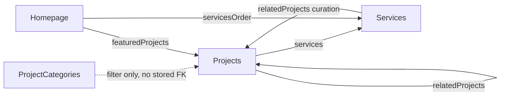

# RAKMYAT — CMS-SCHEMAS.md
### Phase 02 — Locked Payload CMS Schema Specification

**Status:** Documentation only. No Payload config files, collection/global/block definitions, or migrations were created.
**Companion documents:** [PRODUCT.md](./PRODUCT.md) · [DESIGN.md](./DESIGN.md) · [TECHNICAL-ARCHITECTURE.md](./TECHNICAL-ARCHITECTURE.md) · [PAGE-BLUEPRINTS.md](./PAGE-BLUEPRINTS.md)
**Field-naming convention:** `camelCase`, matching Payload convention and directly reusable as TypeScript property names once implemented. Localized fields are marked `localized: true` — these hold the same meaning in both locales but independently authored Arabic/English values (PRODUCT.md §12.1 "localize meaning, not words"), never a machine translation pair.
**Scope discipline:** every collection/global/block below maps to a concrete need already established in PRODUCT.md or DESIGN.md. No collection, field, or block exists "for future flexibility" beyond what prompt §29/§31's explicit registries name. Deferred items (Articles, Industries, Testimonials-as-a-collection) are listed only in §32 as documented future extensions, not built now.

---

## 1. CMS Architecture Overview

Payload CMS runs inside the single Next.js application (TECHNICAL-ARCHITECTURE.md §8/§17). Content is organized into **Collections** (repeatable, independently-published records: projects, services, media, leads, users, pages), **Globals** (singleton records: homepage content, navigation, footer, site-wide settings — one row each, no list view), **Blocks** (the controlled, flexible-content registry used only inside the single-portfolio template's rich content area, prompt §25/§31), and **Repeaters** (Payload `array` fields used wherever a page needs an ordered, editable list that is not itself a block, e.g. process steps or navigation items). Localization is enabled at the field level, not the collection level — every collection/global mixes localized fields (headlines, descriptions) with non-localized fields (slugs, classification enums, media references, ordering numbers) by design, per TECHNICAL-ARCHITECTURE.md §12.

---

## 2. Collections Inventory

| Collection | Purpose | Public-readable? | Admin-only fields |
|---|---|---|---|
| `users` | CMS staff accounts (not public visitors) | No | All |
| `media` | Uploaded images/video/documents | Yes (published assets only, via relationship) | Upload metadata |
| `project-categories` | Taxonomy for filtering the portfolio (prompt §24's classification/service filtering) | Yes | None beyond standard admin fields |
| `services` | The three service pillars + their detail-page content | Yes (published only) | `status` |
| `projects` | Portfolio/case-study records | Yes (published only) | `status`, `clientDisclosureApproved` |
| `leads` | Contact-form submissions | No — never public | All |
| `pages` | Generic legal/simple pages (Privacy at MVP; extensible later) | Yes (published only) | `status` |

---

## 3. Globals Inventory

| Global | Purpose |
|---|---|
| `site-settings` | Site-wide identity: brand name strings, default locale/root-routing config reference, legal entity fields (pending owner input) |
| `navigation` | Primary nav item list + persistent CTA reference |
| `footer` | Footer columns, legal links, locale switcher repeat |
| `homepage` | All eight homepage sections' content (PRODUCT.md §17 / DESIGN.md §27) |
| `about-page` | About page content (prompt §22) |
| `process-page` | Six-stage process content (prompt §23), also feeds homepage §17.6/HOME-06 |
| `contact-settings` | Contact page copy, form field labels, discovery-call fallback behavior text |
| `seo-defaults` | Fallback SEO metadata applied when a collection record doesn't override it |

---

## 4. Users & Roles

### 4.1 `users` collection fields

| Field | Type | Localized | Required | Notes |
|---|---|---|---|---|
| `name` | text | No | Yes | Display name in admin UI |
| `email` | email | No | Yes (unique) | Payload auth field |
| `password` | (Payload auth-managed) | No | Yes | Hashed by Payload's auth system, never stored/displayed plain |
| `role` | select | No | Yes | Options: `super-admin`, `content-editor`, `lead-manager` |

### 4.2 Role → access matrix

| Capability | Super Admin | Content Editor | Lead Manager |
|---|---|---|---|
| Manage `users` | ✅ | ❌ | ❌ |
| Create/edit/publish `projects`, `services`, `pages`, `media` | ✅ | ✅ | ❌ (read-only, for context when handling a lead referencing a project) |
| Edit `homepage`/`about-page`/`process-page`/`navigation`/`footer`/`site-settings`/`seo-defaults` globals | ✅ | ✅ | ❌ |
| Read/manage `leads` | ✅ | ❌ | ✅ |
| Change a project's `classification` or `clientDisclosureApproved` | ✅ | ✅ (with the publishing-rule constraints in §24) | ❌ |
| Delete any record | ✅ | Content records only, not users/leads | Leads only |

---

## 5. Projects Collection

Route-facing purpose: PRODUCT.md §23, prompt §24–§25, §30.

| Field | Type | Localized | Required | Notes |
|---|---|---|---|---|
| `title` | text | Yes | Yes | Project display name |
| `slug` | text | No | Yes (unique) | Shared across locales (TECHNICAL-ARCHITECTURE.md §11 / PRODUCT.md §14) — auto-generated from English title, editable |
| `classification` | select | No | Yes | Options: `real-client`, `internal-product`, `concept-demo`, `confidential-summary` (prompt §30) |
| `industry` | text | Yes | No | Free-text industry label, shown in metadata row (DESIGN.md §18.9) |
| `clientDisplayName` | text | No | Conditionally required if `classification = real-client` | Never shown unless `clientDisclosureApproved = true` |
| `clientDisclosureApproved` | checkbox | No | No (defaults false) | Must be `true` before a `real-client` project can be published — enforced in §24's publishing rules |
| `summary` | textarea | Yes | Yes | One-paragraph archive-card summary |
| `heroMedia` | upload (→ `media`) | No | Yes | 16:10 per DESIGN.md §16 |
| `thumbnail` | upload (→ `media`) | No | Yes | Archive-grid thumbnail, may equal `heroMedia` |
| `featured` | checkbox | No | No | Shown on homepage §17.2/HOME-02 if true |
| `featuredOrder` | number | No | No | Manual ordering among featured projects |
| `archiveOrder` | number | No | No | Manual ordering in `/work` archive, fallback to `publishedAt` desc if unset |
| `services` | relationship (→ `services`, many) | No | Yes (min 1) | Drives "related services" and service-page "related work" queries |
| `challenge` | richText (Lexical) | Yes | Yes | Business challenge narrative |
| `solution` | richText (Lexical) | Yes | Yes | Solution narrative |
| `engineeringDecisions` | array (repeater, see §19) | Yes (per-item) | No | Specific technical decisions, PRODUCT.md §23.2 |
| `technologies` | array of text | No | No | Only populated if genuinely used (PRODUCT.md §23.2 — "no name-dropping") |
| `verifiedOutcomes` | array (repeater, see §19) | Yes (per-item) | No | Only populated when independently verifiable (PRODUCT.md §23.2) |
| `outcomeEvidence` | textarea | No | Conditionally required if `verifiedOutcomes` has entries | Internal-only note on how the outcome was verified — not rendered publicly, exists for editorial accountability |
| `projectGallery` | array of upload (repeater, see §19) | No | No | Additional screenshots beyond hero |
| `flexibleBlocks` | blocks (see §18) | Yes (per-block-field) | No | The single-portfolio template's extensible content area (prompt §25) |
| `relatedProjects` | relationship (→ `projects`, many, max 3) | No | No | Manually curated, not auto-queried, to avoid surfacing an unpublished/misclassified project |
| `seo` | group: `seoTitle` (text, localized), `seoDescription` (textarea, localized), `ogImage` (upload) | Mixed | No | Falls back to `seo-defaults` global if empty |
| `status` | select | No | Yes | Options: `draft`, `published` — controls public query visibility (§24) |
| `publishedAt` | date | No | No | Set automatically on first publish |

---

## 6. Project Categories

Taxonomy collection used purely for portfolio filtering (prompt §24, only active once ≥6 published projects exist).

| Field | Type | Localized | Required | Notes |
|---|---|---|---|---|
| `name` | text | Yes | Yes | e.g. "Custom Software," mirrors a `services` pillar name or a finer-grained industry tag — exact taxonomy source is content-editorial, not re-specified here beyond the mechanism |
| `slug` | text | No | Yes (unique) | Used in `/work?category=slug` query param |

---

## 7. Services Collection

Drives `/services` archive and the three shared-template detail pages (prompt §20–§21).

| Field | Type | Localized | Required | Notes |
|---|---|---|---|---|
| `title` | text | Yes | Yes | e.g. "Custom Software Engineering" / "هندسة البرمجيات المخصصة" (PRODUCT.md §8) |
| `slug` | text | No | Yes (unique) | `custom-software` / `enterprise-solutions` / `ai-agents-automation` — locked values, PRODUCT.md §16 |
| `pillarNumber` | number | No | Yes | 1/2/3, drives the "01/02/03" editorial numbering (DESIGN.md §18.8) |
| `summary` | textarea | Yes | Yes | One-sentence value proposition (PRODUCT.md §9.7) |
| `problems` | array (repeater, see §19) | Yes (per-item) | No | "Business Problems We Solve" section (prompt §21) |
| `deliverables` | array (repeater, see §19) | Yes (per-item) | No | "Scope & Deliverables" section |
| `architectureDiagram` | group: `diagramAsset` (upload, SVG), `diagramLabel` (text, localized), `diagramDescription` (textarea, localized, for accessibility equivalence) | Mixed | No | DESIGN.md §15/§28.1 — one diagram per service page |
| `processSummary` | richText (Lexical) | Yes | No | Short "Our Engineering Approach" text, distinct from the full Process page |
| `relatedProjects` | relationship (→ `projects`, many) | No | No | Auto-filterable by `services` field on the Projects side, but stored here too for manual curation override |
| `cta` | group: `ctaLabel` (text, localized, defaults to "Start a Project"/"ابدأ مشروعك"), `ctaHref` (text, defaults `/contact`) | Mixed | No | |
| `seo` | same shape as §5's `seo` group | Mixed | No | |
| `status` | select (`draft`/`published`) | No | Yes | |

---

## 8. Pages Collection

Generic collection for simple, mostly-static legal/informational pages. At MVP this holds exactly one record: Privacy (prompt §27). Deliberately not used for homepage/about/process/contact, which are Globals (§3) because they are singletons with highly specific, non-generic section structures — `pages` is reserved for content that is genuinely generic rich text.

| Field | Type | Localized | Required | Notes |
|---|---|---|---|---|
| `title` | text | Yes | Yes | |
| `slug` | text | No | Yes (unique) | `privacy` at MVP |
| `body` | richText (Lexical) | Yes | Yes | Legal text — PENDING OWNER/LEGAL APPROVAL (PRODUCT.md §18.8/§34); the field exists regardless so editors have somewhere to put approved text once received |
| `lastReviewedAt` | date | No | No | Legal-content versioning aid |
| `seo` | same shape as §5 | Mixed | No | |
| `status` | select (`draft`/`published`) | No | Yes | |

---

## 9. Media Collection

| Field | Type | Localized | Required | Notes |
|---|---|---|---|---|
| `alt` | text | Yes | Yes | Accessibility requirement (DESIGN.md §32) — never left empty |
| `caption` | text | Yes | No | Optional visible caption (case-study galleries) |
| (Payload-managed: filename, mimeType, filesize, width, height, sizes/variants) | — | No | Yes (system-managed) | Payload auto-generates responsive size variants per TECHNICAL-ARCHITECTURE.md §24 |

**Upload constraints:** accepted MIME types restricted to `image/avif`, `image/webp`, `image/png`, `image/jpeg`, `image/svg+xml`, `video/mp4` (hero/mobile-fallback video loops only, DESIGN.md §16's ≤3MB/≤8s rule enforced editorially, not by the schema). Max file size enforced at the Payload upload config level (exact byte limit is an implementation-time tuning task, not invented here — guided by DESIGN.md §33's budgets).

### 9.1 Phase 03 Addendum — Asset Provenance Fields

Added to support DESIGN.md §42's asset-generation authorization without weakening the authenticity rules (PRODUCT.md §26/§29, DESIGN.md §42.3):

| Field | Type | Localized | Required | Notes |
|---|---|---|---|---|
| `provenance` | select | No | Yes (default `original-production`) | Options: `original-production` (commissioned/human-made), `ai-generated` (per DESIGN.md §42.1), `procedural` (code-constructed — Three.js/SVG/CSS), `client-supplied` (a real project screenshot) |
| `conceptualOnly` | checkbox | No | No | `true` for any illustrative/conceptual asset not representing real delivered work (ties to PRODUCT.md §25 Demo Project Strategy) — internal bookkeeping; does not replace the public classification badge already required on `projects` (§5/§24) wherever one applies |

**Rationale:** operationalizes "never fabricate... conceptual imagery allowed when clearly identified as conceptual" at the data layer, so provenance is always answerable per-asset without re-litigating it editorially each time, and so a future audit can query "which hero/background assets are AI-generated vs. procedurally built vs. commissioned" directly.

---

## 10. Leads Collection

Never public. PRODUCT.md §21, prompt §26.

| Field | Type | Localized | Required | Notes |
|---|---|---|---|---|
| `fullName` | text | No | Yes | |
| `workEmail` | email | No | Yes | |
| `companyName` | text | No | Yes | |
| `projectType` | select | No | Yes | Options: `custom-software`, `enterprise-solutions`, `ai-agents-automation`, `not-sure` |
| `projectDescription` | textarea | No | Yes | Min 20 characters, enforced by the shared Zod schema server-side (TECHNICAL-ARCHITECTURE.md §20), not re-enforced redundantly at the Payload field level beyond `required: true` |
| `budgetRange` | select | No | No | Owner-approved brackets only (PRODUCT.md §21/§34 — currency 🔴 pending; options list intentionally left for owner definition, not invented here) |
| `timeline` | select | No | No | Options: `asap`, `1-3-months`, `3-6-months`, `flexible` |
| `locale` | text | No | Yes (system-set) | Which locale the form was submitted from — useful for Lead Manager triage |
| `discoveryCallRequested` | checkbox | No | No | Set `true` when the submission originated from the "Book a Discovery Call" CTA fallback path (PRODUCT.md §22) |
| `sourcePage` | text | No | Yes (system-set) | Attribution |
| `status` | select | No | Yes (defaults `new`) | Options: `new`, `contacted`, `qualified`, `closed` — internal triage only, Lead Manager-editable |
| `submittedAt` | date | No | Yes (system-set) | |

**Access:** create = public (via the validated Server Action only, never a direct public API write); read/update/delete = Super Admin + Lead Manager only (§4.2).

---

## 11. Homepage Global

Maps 1:1 to PRODUCT.md §17 / DESIGN.md §27's eight sections.

| Field group | Key fields | Localized | Notes |
|---|---|---|---|
| `hero` (HOME-01) | `headline`, `subheadline`, `primaryCtaLabel`, `primaryCtaHref`, `secondaryCtaLabel`, `secondaryCtaHref`, `sculptureAsset` (upload — 3D model/texture bundle reference or a structured reference to the static build asset, exact type depends on asset pipeline chosen at implementation), `sculptureFallback` (upload, mobile static/video), `heroAccessibilityDescription` (textarea, localized) | Text fields localized; assets shared | Content locked in PRODUCT.md §9.2–§9.3/§17.1 |
| `selectedWork` (HOME-02) | `sectionLabel`, `featuredProjects` (relationship → `projects`, many, manually curated order) | `sectionLabel` localized | Falls back to the honest empty state (PRODUCT.md §17.2) when the relationship is empty |
| `whatWeCreate` (HOME-03) | `sectionLabel`, `servicesOrder` (relationship → `services`, ordered) | `sectionLabel` localized | Pulls each service's `title`/`summary` from the Services collection — not duplicated here |
| `systemsInMotion` (HOME-04) | `sectionHeadline`, `sectionDescription`, `stages` (array, 3 items fixed — see §19), `fallbackMedia` (upload) | Yes | Exactly 3 stages, matching PRODUCT.md §17.4's fixed narrative — `minRows: 3, maxRows: 3` |
| `engineeringBehind` (HOME-05) | `headline`, `description`, `engineeringPrinciples` (array, see §19), `supportingDiagram` (upload, SVG), `cta` (group: label/href) | Yes | PRODUCT.md §17.5 |
| `visionToReality` (HOME-06) | Pulled from `process-page` global's `steps` field (§13) — this section does not duplicate the six stages, it references them | — | Avoids maintaining the six-stage content in two places |
| `philosophy` (HOME-07) | `manifestoHeadline`, `manifestoBody`, `optionalSupportingLabel` | Yes | PRODUCT.md §17.7 — draft content flagged `NEEDS OWNER REVIEW` at the content-matrix level (PRODUCT.md §12.2), not re-flagged per field here |
| `finalConversion` (HOME-08) | `headline`, `primaryCtaLabel`, `primaryCtaHref`, `secondaryCtaLabel`, `secondaryCtaHref`, `nextStepNote` (textarea, localized — PRODUCT.md §17.8's "no invented response time" copy) | Yes | |
| `seo` | same shape as §5 | Mixed | Homepage-specific SEO override |

---

## 12. About Global

Prompt §22.

| Field | Type | Localized | Notes |
|---|---|---|---|
| `heroHeadline`, `heroSubhead` | text/textarea | Yes | |
| `brandStory` | richText | Yes | PENDING OWNER APPROVAL per prompt §22's explicit instruction — field exists, content status tracked editorially, not technically gated |
| `philosophyBody` | richText | Yes | May reference/reuse Homepage §17.7 copy conceptually but is written as its own passage, not a duplicate field binding |
| `beliefs` | array of {`title` (text, localized), `description` (textarea, localized)} | Per-item | "What We Believe" section |
| `howWeWork` | richText | Yes | Short version; full process lives on the Process global |
| `capabilities` | array of {`label` (text, localized)} | Per-item | |
| `teamMembers` | array of {`name` (text), `role` (text, localized), `photo` (upload)} | Per-item (role only) | **Optional, empty by default.** Section 07 of the About page (prompt §22) is omitted entirely from render when this array is empty — never populated with placeholder people (PRODUCT.md §18.5/§34 🔴) |
| `cta` | group: label/href ×2 | Mixed | |
| `seo` | same shape as §5 | Mixed | |

---

## 13. Process Global

Prompt §23; also feeds Homepage HOME-06 (§11).

| Field | Type | Localized | Notes |
|---|---|---|---|
| `heroHeadline`, `heroSubhead` | text/textarea | Yes | |
| `steps` | array, exactly 6 items (`minRows: 6, maxRows: 6`) — see §19 for item schema | Per-item | The six locked stages: Discovery, Architecture, Product Design, Engineering, Validation, Launch & Evolution (PRODUCT.md §17.6) — order is fixed by array position, not independently re-orderable by an editor, since the sequence is a locked business decision, not editorial content |
| `qualityPrinciples` | array of {`title` (text, localized), `description` (textarea, localized)} | Per-item | "Quality & Validation Approach" (prompt §23) |
| `cta` | group: label/href | Mixed | |
| `seo` | same shape as §5 | Mixed | |

---

## 14. Navigation Global

| Field | Type | Localized | Notes |
|---|---|---|---|
| `items` | array (repeater, see §19) — fixed order: Work, Services, Process, About, Contact (PRODUCT.md §15/prompt §9) | Per-item label | `minRows`/`maxRows` not fixed at 5 (future nav items are an editorial possibility) but the **order and set of these five is locked** at MVP — a Content Editor can edit labels/hrefs but the registry itself is not meant to be arbitrarily restructured without a DESIGN.md/PRODUCT.md update first |
| `primaryCta` | group: `label` (text, localized), `href` (text, default `/contact`) | label only | "Start a Project" persistent CTA (DESIGN.md §18.1) |

---

## 15. Footer Global

| Field | Type | Localized | Notes |
|---|---|---|---|
| `missionOneLiner` | text | Yes | Brand column |
| `navigationLinks` | array (repeater, see §19) | Per-item label | Mirrors primary nav, editorially independent |
| `serviceLinks` | array (repeater, see §19) | Per-item label | Links to the three service detail pages |
| `contactLinks` | array (repeater, see §19) | Per-item label | Email/phone/address once available (PRODUCT.md §34 🔴) |
| `legalLinks` | array of {`label` (text, localized), `href` (text)} | Per-item label | `/privacy` at MVP |
| `copyrightText` | text | Yes | |

---

## 16. Contact Settings Global

Prompt §26.

| Field | Type | Localized | Notes |
|---|---|---|---|
| `heroHeadline`, `heroSubhead` | text/textarea | Yes | |
| `formFieldLabels` | group of text pairs (en/ar handled via localization, not separate fields) for: `fullName`, `workEmail`, `companyName`, `projectType`, `projectDescription`, `budgetRange`, `timeline` | Yes (per label) | Mirrors PRODUCT.md §21's field table exactly — this is the CMS-editable *label* layer; the underlying Zod validation schema (TECHNICAL-ARCHITECTURE.md §20) is code, not CMS content, and must stay in sync manually |
| `projectTypeOptions` | array of {`value` (text), `label` (text, localized)} | Per-item label | Must match `services` collection slugs + a "Not sure yet" option (PRODUCT.md §21) |
| `budgetRangeOptions` | array of {`value` (text), `label` (text, localized)} | Per-item label | **Empty by default — PENDING OWNER INPUT on currency/brackets (PRODUCT.md §21/§34 🔴).** Field optional on the live form until populated |
| `timelineOptions` | array of {`value` (text), `label` (text, localized)} | Per-item label | Pre-populated with the four PRODUCT.md §21 options |
| `contactMethods` | array (repeater, see §19) | Per-item label | |
| `whatHappensNextCopy` | textarea | Yes | PRODUCT.md §17.8's "no invented response time" rule applies here too |
| `discoveryFallbackNotice` | textarea | Yes | The "not available yet, routes to contact form" copy (PRODUCT.md §22) |

---

## 17. SEO Defaults Global

| Field | Type | Localized | Notes |
|---|---|---|---|
| `defaultTitleTemplate` | text | Yes | e.g. `%s — Rakmyat` / `%s — رقميات` |
| `defaultDescription` | textarea | Yes | |
| `defaultOgImage` | upload | No | |
| `organizationSchema` | group: `legalName` (text, 🔴 pending PRODUCT.md §34), `alternateName` (text — the Arabic brand name for schema purposes), `url`, `logo` (upload) | Partial | Feeds `Organization` JSON-LD (TECHNICAL-ARCHITECTURE.md §22) |

---

## 18. Flexible Blocks Registry

Used exclusively inside `projects.flexibleBlocks` (§5), per prompt §25/§31's explicit scoping — not available as a field type anywhere else, which is the enforced "controlled block registry" (prompt §31's "do not allow arbitrary styling/JS, use a controlled registry").

| Block slug | Purpose | Repeatable | Key fields |
|---|---|---|---|
| `richText` | Editorial narrative | Yes | `content` (Lexical, localized) |
| `splitContent` | Text + media composition | Yes | `heading` (text, localized), `body` (richText, localized), `media` (upload), `mediaPosition` (select: `start`/`end` — logical, not left/right, per DESIGN.md §9.5) |
| `fullBleedMedia` | Large image/video showcase | Yes | `media` (upload), `caption` (text, localized, optional) |
| `imageGallery` | Multiple project screenshots | Yes | `images` (array of upload, min 2) — rendered via Embla only here (prompt §25/TECHNICAL-ARCHITECTURE.md §10) |
| `videoShowcase` | Product demonstration | Yes | `video` (upload, `video/mp4`), `poster` (upload, required), `caption` (text, localized, optional) |
| `featureGrid` | Structured feature list | Yes | `features` (array of {`label` text localized, `description` textarea localized}) — **not** used for the homepage service pillars (DESIGN.md §36 forbids three-card grids there); this block is for in-depth case-study feature breakdowns only |
| `architectureDiagram` | Technical system explanation | Yes | `diagram` (upload, SVG), `description` (textarea, localized, accessibility-equivalent text per DESIGN.md §15/§32) |
| `technologyStack` | Verified technologies | Yes | `groups` (array, see §19 Technology Stack Groups repeater) |
| `processTimeline` | Project-specific workflow | Yes | `steps` (array of {`label` text localized, `description` textarea localized}) — distinct from the global six-stage Process (§13); this is case-study-specific |
| `verifiedMetrics` | Evidence-backed outcomes | Yes | `metrics` (array of {`value` text, `label` text localized, `evidenceNote` textarea — internal only}) — gated by the same "only if verifiable" rule as `projects.verifiedOutcomes` (§5) |
| `approvedTestimonial` | Client-approved quote | Yes | `quote` (textarea, localized), `attribution` (text), `approvalReference` (text, internal-only — who approved it and when) — **publish-blocked without `approvalReference` populated**, enforced editorially per PRODUCT.md §26's hard rule |
| `quote` | Editorial (non-client) quote | Yes | `text` (textarea, localized), `attribution` (text, optional) |
| `cta` | Project inquiry prompt | Yes | `label` (text, localized), `href` (text) |
| `relatedProjects` | Related case studies | Once (`maxRows: 1` at the parent-array level, or enforced via admin UI validation) | References `projects.relatedProjects` (§5) rather than duplicating the relationship — this block is a *placement marker* for where that relationship renders within the flexible flow, not a second data source |

Every block additionally carries (Payload-managed, not separately specified per block): a stable `blockType` slug, `localized` text fields exactly as listed, and no `customCss`/`customJs` field of any kind (prompt §31's hard prohibition).

---

## 19. Repeater Field Schemas

| Repeater (used in) | Item schema | Min/Max | Localized fields | Notes |
|---|---|---|---|---|
| Project gallery images (`projects.projectGallery`) | `{ image: upload, caption: text (localized, optional) }` | 0–20 | `caption` | |
| Engineering decisions (`projects.engineeringDecisions`) | `{ decision: text (localized), rationale: textarea (localized, optional) }` | 0–10 | both | PRODUCT.md §23.2 |
| Technology stack groups (`technologyStack` block) | `{ groupLabel: text (localized), items: array of text }` | 0–6 groups | `groupLabel` | |
| Verified outcomes (`projects.verifiedOutcomes`) | `{ outcome: text (localized), metric: text (optional) }` | 0–8 | `outcome` | Gated by `outcomeEvidence` field at the parent level (§5) |
| Service deliverables (`services.deliverables`) | `{ deliverable: text (localized) }` | 1–8 | yes | |
| Service problems (`services.problems`) | `{ problem: text (localized), description: textarea (localized, optional) }` | 1–6 | both | |
| Process steps (`process-page.steps`) | `{ stepNumber: number (fixed 1–6), title: text (localized), description: textarea (localized), deliverables: array of text (localized) }` | exactly 6 | title/description/deliverables | Order locked (§13) |
| Team members (`about-page.teamMembers`) | `{ name: text, role: text (localized), photo: upload }` | 0–20 | role only | Optional, PRODUCT.md §18.5/§34 🔴 |
| Contact methods (`contact-settings.contactMethods`) | `{ method: text (localized label, e.g. "Email"), value: text }` | 0–5 | label only | `value` (actual email/phone) is 🔴 pending PRODUCT.md §34 |
| Navigation items (`navigation.items`) | `{ label: text (localized), href: text, order: number }` | exactly 5 at MVP | label | §14 |
| Footer links (`footer.navigationLinks`/`serviceLinks`) | `{ label: text (localized), href: text }` | per-list, unconstrained small list | label | §15 |
| Related projects (`projects.relatedProjects`) | relationship, not an array-of-object repeater | 0–3 | — | §5 |
| Systems in Motion stages (`homepage.systemsInMotion.stages`) | `{ stageTitle: text (localized), stageDescription: textarea (localized), stageAccessibilityText: textarea (localized) }` | exactly 3 | all three | PRODUCT.md §17.4 |
| Engineering principles (`homepage.engineeringBehind.engineeringPrinciples`) | `{ principle: text (localized), description: textarea (localized) }` | 1–7 (Architecture/Security/Testing/Performance/Monitoring/Maintainability/Scalability per PRODUCT.md §17.5) | both | |

No repeater is pre-populated with placeholder/example content in the schema itself — empty arrays render the documented empty states (§24, PRODUCT.md's empty-state rules), never fabricated filler.

---

## 20. Localization

Payload locale config: `locales: ['en', 'ar-EG']`, `defaultLocale: 'en'` (the CMS-internal default, independent of the public root-routing negotiation policy in PRODUCT.md §14/TECHNICAL-ARCHITECTURE.md §12 — Payload's `defaultLocale` only affects what the admin UI shows first and what a field falls back to if a translation is missing, it does not drive the public site's locale-negotiation redirect). Every field marked `localized: true` throughout §5–§17 stores two independent values keyed by locale; the admin UI presents both side-by-side per Payload's standard localized-field editor, satisfying PRODUCT.md §12's "both languages written first, independently" requirement at the tooling level — nothing about the schema allows a "translate from English" shortcut workflow, but editorial process (actually writing Arabic natively rather than pasting a translation into the Arabic field) is a people/process matter this schema cannot enforce technically, and is called out as an editorial-discipline requirement in PRODUCT.md §12.1, not re-solved here.

**Missing-translation fallback:** if an Arabic value is empty for a localized field, Payload's `fallback: true` locale config serves the English value rather than a blank — this is a *technical* fallback for robustness, not a signal that machine-translated copy is acceptable; editorial workflow should treat any such fallback occurrence as a flagged gap to fill, not a shipped final state.

---

## 21. Shared Slug Strategy

`projects.slug` and `services.slug` are the **only** slugged fields, and both are **not locale-scoped** — one slug value serves both `/en/work/{slug}` and `/ar/work/{slug}` (PRODUCT.md §14's shared-English-derived-slug policy, TECHNICAL-ARCHITECTURE.md §11). This means: one `projects` record = one project, with localized title/summary/narrative fields inside it — never two separate records for the English and Arabic version of the same project. Slug uniqueness is enforced at the collection level (`unique: true`), not per-locale, which is exactly the mechanism needed to guarantee the shared-slug policy actually holds at the data layer, not just by editorial convention.

---

## 22. Relationships

`project-categories` is deliberately **not** a relationship field stored on `projects` — portfolio filtering by classification/service (prompt §24) uses the `classification` enum and `services` relationship already on the `projects` record directly; a separate `project-categories` taxonomy only matters if a finer-grained industry/tag filter is added once ≥6 projects exist, at which point it would become a genuine relationship field — documented here as the mechanism, not implemented prematurely as an unused relationship today.

---

## 23. Validation

| Validation concern | Enforcement layer |
|---|---|
| Field-level required/format (email, min-length) | Payload field config (`required`, `minLength`, custom `validate` functions) |
| Cross-field business rules (e.g. `real-client` requires `clientDisclosureApproved`) | Payload collection `hooks.beforeValidate`/`beforeChange` — documented in §24, not a plain field constraint since it spans two fields |
| Contact-form field validation | Duplicated intentionally at two layers per TECHNICAL-ARCHITECTURE.md §20: client-side Zod (fast feedback) and server-side Zod (trust boundary) — the Leads collection's own field `required` flags are a third, final backstop, not the primary validation layer |
| Exactly-6 process steps / exactly-3 Systems-in-Motion stages | `minRows`/`maxRows` set equal on the array field config |

---

## 24. Publishing Workflow

- Every content collection (`projects`, `services`, `pages`) uses Payload's draft/published pattern via the `status` field (§5/§7/§8) — public queries filter `status: 'published'` always; the admin UI can preview drafts (§25).
- **Hard publishing rule for `projects` (enforced via a `beforeChange` hook, documented here as a requirement, not yet code):** a record cannot be saved with `status: 'published'` AND `classification: 'real-client'` AND `clientDisclosureApproved: false` simultaneously — the save is rejected with a validation error naming the conflict. This is the technical enforcement of PRODUCT.md §23.1's "never relabel a Concept/Demo as a Real Client Project to fill the section" rule and the broader §26 "no fabricated claims" rule.
- Similarly, a `projects` record cannot publish with non-empty `verifiedOutcomes` unless `outcomeEvidence` is also non-empty (same mechanism).
- An `approvedTestimonial` block cannot be considered "complete" (editorially, flagged in the admin preview) without `approvalReference` populated — this one is a softer editorial nudge rather than a hard save-blocker, since testimonials live inside a nested block array where a hard hook is harder to scope cleanly; documented as a VERIFY-AT-IMPLEMENTATION decision on whether to make it a hard block too.

---

## 25. Preview Workflow

Payload's live-preview feature (draft content rendered against the real frontend route before publishing) is used for `projects` and `services` at minimum, given their visual complexity (hero media, flexible blocks, diagrams) — a Content Editor should see the actual DESIGN.md-specified layout before publishing, not just raw field values in the admin grid. Exact live-preview URL wiring is an implementation-time configuration task (Payload's `admin.livePreview` config pointing at the correct locale-prefixed route), not detailed further here since it introduces no new content/schema decision.

---

## 26. Access Control

Restated and cross-referenced from TECHNICAL-ARCHITECTURE.md §21 at the schema level:

| Collection/Global | Public read | Content Editor write | Lead Manager write | Super Admin |
|---|---|---|---|---|
| `projects`, `services`, `pages` | `status: 'published'` only | ✅ | ❌ | ✅ |
| `media` | Only assets referenced by a published record (enforced by not exposing an unauthenticated list endpoint, not by a field-level flag) | ✅ | ❌ | ✅ |
| `homepage`, `about-page`, `process-page`, `navigation`, `footer`, `site-settings`, `seo-defaults` (globals) | Read-only, full content (these are not draft-gated — they're always "live" singletons) | ✅ | ❌ | ✅ |
| `leads` | ❌ never | ❌ | ✅ (read/update status only, no delete) | ✅ (full) |
| `users` | ❌ | ❌ | ❌ | ✅ |
| `contact-settings` global | Read-only | ✅ | ❌ | ✅ |

---

## 27. Media Storage

Schema-level implication of TECHNICAL-ARCHITECTURE.md §19/ADR-007: the `media` collection stores a relative storage path + generated size-variant metadata (Payload's standard upload field shape), **not** an absolute local-filesystem path and **not** a hard-coded CDN domain — this is what makes the documented future S3-compatible migration (TECHNICAL-ARCHITECTURE.md §19) a storage-adapter swap rather than a schema/data migration.

---

## 28. Database Indexes

| Field | Index type | Reason |
|---|---|---|
| `projects.slug` | Unique | Shared-slug lookup (§21), route resolution |
| `services.slug` | Unique | Route resolution |
| `pages.slug` | Unique | Route resolution |
| `projects.status` | Standard | Public-query filtering, every portfolio/homepage query |
| `projects.classification` | Standard | Portfolio filtering (prompt §24) |
| `projects.featured` | Standard | Homepage §17.2 query |
| `services.slug` + `projects.services` (relationship) | Standard (relationship join) | Service↔project lookups on both archive and detail pages |
| `leads.status` | Standard | Lead Manager triage queries |
| `leads.submittedAt` | Standard | Chronological lead list sort |
| `users.email` | Unique | Auth |

---

## 29. Data Retention

- `leads`: retained indefinitely at MVP pending an explicit owner/legal retention policy (PRODUCT.md §34's privacy-policy gap, prompt §27) — once that policy exists, a scheduled deletion/anonymization job becomes a documented future extension (§32), not built speculatively now.
- `media`: retained as long as referenced by any collection record; an "orphaned media" admin report (listing uploads with zero references) is a documented future extension, not MVP.
- CMS draft content: no auto-expiry; drafts persist until an editor publishes or deletes them.

---

## 30. Cache Invalidation

Next.js's data-cache/revalidation (App Router `revalidatePath`/`revalidateTag`) is triggered from a Payload `afterChange` hook on `projects`, `services`, `pages`, and every Global — so publishing a change in the CMS invalidates exactly the routes that record affects (e.g. publishing a project revalidates `/en/work`, `/ar/work`, `/en/work/{slug}`, `/ar/work/{slug}`, and any service page that lists it as related work) rather than a blanket full-site revalidation on every save, which would undermine the ISR/caching performance strategy in TECHNICAL-ARCHITECTURE.md §24.

---

## 31. Admin UX

- Admin UI groups collections in the sidebar as: **Content** (`projects`, `services`, `pages`, `media`), **Site** (all Globals), **Leads** (`leads`), **Users** (`users`) — a navigational grouping decision, not a schema change, included here because prompt §43 asks this document to cover admin UX, not because it alters any field.
- `projects` list view default columns: `title`, `classification`, `status`, `featured`, `publishedAt` — surfaces the one piece of information (classification) that PRODUCT.md §26 treats as the most editorially sensitive field, so it's never buried.
- Locale switcher inside the admin UI itself (Payload's built-in locale selector for localized fields) is separate from the public site's language switcher (DESIGN.md §20) — an editor can view/edit both `en` and `ar-EG` content side-by-side or toggled, per Payload's standard localized-admin UX.

---

## 32. Future Schema Extensions

Explicitly **not** built at MVP (prompt §29's "deferred collections" + PRODUCT.md §37):

| Deferred item | Trigger for building it |
|---|---|
| `articles` collection | When `/insights` (PRODUCT.md §37 Phase 2) gets real authored content and an owner-approved content pipeline |
| `industries` collection | If portfolio filtering by industry (beyond `project-categories`' simple tag mechanism) becomes necessary at scale |
| `testimonials` as a standalone collection | If/when the owner approves real client testimonials beyond the per-project `approvedTestimonial` block (§18) — a dedicated collection would make sense once testimonials are reused across multiple contexts (e.g. a future homepage trust section), not before |
| Audit-log collection | If Payload's built-in timestamp fields (§21 of TECHNICAL-ARCHITECTURE.md) prove insufficient for compliance/security needs |
| Scheduled lead-retention job | Once a privacy policy with a defined retention period is approved (§29) |

---

## 33. Schema Acceptance Criteria

- [x] Every collection/global named in the prompt's §29/§42 structure has a complete field-by-field table (§5–§17).
- [x] Every block in the prompt §31 registry has a schema (§18); none expose custom CSS/JS fields.
- [x] Every repeater named in prompt §32 has an item schema with min/max, localization, and empty-state behavior documented (§19).
- [x] The portfolio classification system's hard publishing rule (no fabricated real-client claims) is enforced at the schema/hook level, not left as a documentation-only promise (§24).
- [x] Shared-slug strategy matches PRODUCT.md §14/§21's locked routing policy exactly — one record per project/service, not per-locale duplicates (§21).
- [x] Access control matrix matches the three-role system from the prompt §29 exactly (§4.2/§26).
- [x] No collection, field, or block was invented beyond what PRODUCT.md, DESIGN.md, or the prompt's registries actually require; deferred items are listed, not built (§32).
- [x] No Payload config files, collection definitions, or migrations were created — this document is schema specification only.
