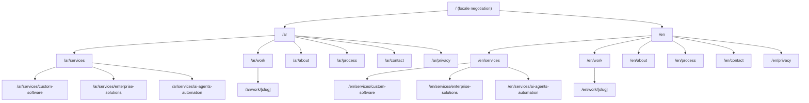

# RAKMYAT — PRODUCT.md
### Master Product, Brand & Bilingual Strategy Document

**Status:** Phase 01 — Documentation & Creative Direction (no implementation performed)
**Companion document:** [DESIGN.md](./DESIGN.md) — visual, motion, and token specification. The two files share one source of truth for positioning, routes, CTAs, service names, and bilingual requirements. Where this file states a rule, DESIGN.md implements it visually; neither file should be read in isolation.
**Brand:** Rakmyat (EN) / رقميات (AR)
**Domain:** 🔴 OWNER DECISION REQUIRED — canonical production domain unconfirmed. `rakmyat.com` was the originally assumed address in this document; the brand's social-media presence has since used `rakmyat.online`. Neither is confirmed registered, hosted, or the intended canonical domain — do not infer ownership or a changed decision from either. All domain-dependent specifications (sitemap, canonical URLs, Caddy config, metadata) must read the domain from an environment variable, never a hardcoded value, until the owner confirms. This does not block local development; it blocks production canonicalization and launch configuration (TECHNICAL-ARCHITECTURE.md §28, PLAN.md §26).
**Category:** Custom Software Engineering · Enterprise Technology Solutions · AI Agents & Intelligent Automation
**Creative direction:** Creative Digital Powerhouse — Ultra-Premium Immersive Digital Experience
**Theme:** Porcelain-first (light), no toggle — Cobalt Blue & Porcelain identity; exactly two homepage sections (HOME-04, HOME-08) use a deliberate deep-cobalt dark treatment, never a site-wide default (migrated from the original Navy/Cyan/Obsidian dark-only direction; see DESIGN.md §5/§43 and COBALT-PORCELAIN-MIGRATION-REPORT.md)
**Locales:** `ar-EG` (Egyptian Arabic, RTL) and `en` (international B2B English, LTR) — both mandatory at launch, equal depth, equal quality
**Legend used throughout:** 🟢 CONFIRMED (owner-stated fact) · 🟡 RECOMMENDATION (our directional decision, override-able) · 🔵 ASSUMPTION (unverified, flagged) · 🔴 MISSING INPUT (blocks a real-world dependency, not the documentation)

---

## 1. Executive Product Vision

Rakmyat exists to be the engineering partner a serious business calls when the problem is too complex for a template and too important for a freelancer. The website's job is to make that credible in under sixty seconds of scrolling: an Egyptian-rooted, internationally fluent software engineering company that designs and ships custom software, enterprise systems, and AI-driven automation with the visual polish of a top-tier creative studio and the technical rigor of an enterprise vendor.

The site is not a storefront. It is a filtering and persuasion instrument: it should repel low-budget, low-complexity inquiries through tone and content density, and pull in decision-makers who are evaluating a multi-month engagement. Every section exists to either (a) prove engineering competence, (b) prove design/product competence, (c) clarify what Rakmyat actually builds, or (d) move a qualified visitor toward a project inquiry or discovery call. Sections that do none of these are cut.

🟡 The bilingual requirement is treated as a product differentiator, not a localization afterthought: a global software vendor with native-quality Egyptian Arabic is itself a credibility signal for the regional market, and a sign of engineering discipline (logical CSS, direction-aware components) for the international one.

---

## 2. Company Overview

| Field | Value | Status |
|---|---|---|
| English name | Rakmyat | 🟢 |
| Arabic name | رقميات | 🟢 |
| Domain | `rakmyat.com` (original assumption) vs. `rakmyat.online` (observed on recent social-media materials) | 🔴 OWNER DECISION REQUIRED — neither confirmed; see header metadata above |
| Category | Custom Software Engineering, Enterprise Technology Solutions, AI Agents & Intelligent Automation | 🟢 |
| Company stage | New brand/website build; no evidence of prior public site, legal entity type, headcount, or office location | 🔵 |
| Service languages (spoken business language) | Arabic (Egypt) and English | 🟢 |
| Target geography | Egypt/MENA primary, international English-speaking B2B secondary | 🔵 — see §5 |
| Legal entity, registration, address | Not provided | 🔴 |
| Team size, named leadership, bios | Not provided | 🔴 |

Rakmyat is positioned as a **custom software engineering and intelligent automation company**, not a web design agency, not a marketing agency, not a chatbot reseller, and not a staff-augmentation/outsourcing shop. The three service pillars (§8) are the entire scope of what the company sells; nothing on the site should imply additional services (branding, marketing, hosting resale, hardware) unless the owner confirms them.

---

## 3. Business Objectives

### 3.1 Primary objectives
1. Create an immediate, unambiguous impression of technical and design excellence.
2. Establish premium brand perception distinct from generic software houses.
3. Make the three service pillars understandable to a non-technical buyer in under two minutes.
4. Demonstrate engineering maturity through real practices, not claims (§26).
5. Build trust with decision-makers who are risk-averse about vendor selection.
6. Convert qualified attention into project inquiries via the contact flow (§21).
7. Route high-intent visitors to a discovery call rather than a cold form where appropriate (§22).
8. Differentiate from (a) cheap freelance marketplaces, (b) generic AI-chatbot vendors, (c) template-based software houses.
9. Serve Arabic and English visitors as equally primary audiences — neither is a "translation" of the other (§9–§13).
10. Prove the above by the quality of the site itself: the website is the first work sample.

### 3.2 Measurable targets & tracking (🟡 recommendation — no historical data exists to benchmark against)

| Metric | Target (post-launch, to validate not assume) | Why |
|---|---|---|
| Homepage → Service page or Work page click-through | ≥ 35% of sessions | Confirms hero + nav are doing their job |
| Contact/Start-a-Project form start rate | ≥ 4% of sessions | Lead-gen health |
| Form completion rate (started → submitted) | ≥ 60% | Flags friction if lower |
| Bounce on hero (< 10s) | < 40% | Flags a weak or slow hero |
| LCP (mobile, 75th percentile) | ≤ 2.5s | Performance budget, §31 |
| Language-switch usage | Track volume per locale | Validates default-locale policy, §14 |
| Discovery call bookings (once scheduling exists) | Track, no target until baseline exists | 🔴 depends on booking tool, §30 |

🔴 No analytics platform, CRM, or current traffic baseline has been provided — targets above are directional and must be revisited once real data exists.

---

## 4. Brand Positioning

**Market category:** Premium custom software engineering firm with a specialized AI-agents/automation practice — adjacent to boutique enterprise software consultancies, distinct from digital marketing agencies, no-code platforms, and freelance marketplaces.

**Positioning statement:**
> Rakmyat is the software engineering partner for organizations whose operations have outgrown off-the-shelf tools — we design and build custom platforms, enterprise systems, and AI-driven automation with the design discipline of a top-tier studio and the engineering rigor of an enterprise vendor.

**Brand promise (deliberately unguaranteed):**
> We commit to engineering decisions we can defend, design that earns attention honestly, and communication that never overstates what a system can do. We do not promise timelines, cost savings, or outcomes we have not yet earned the right to claim.

**Relationship between the three pillars:**
- *Custom Software Engineering* is the foundation discipline — the ability to design and ship correct, maintainable software for a specific business problem.
- *Enterprise Technology Solutions* applies that discipline at organizational scale — integrating, replacing, or connecting the systems a growing company already depends on.
- *AI Agents & Automation* is the newest and most differentiated layer — using the same engineering discipline to automate decisions and workflows, built *on top of* solid software foundations rather than as a bolt-on chatbot.

🟡 Recommendation: never present "AI Agents" as a standalone product category separable from software engineering — every AI deliverable should be framed as "software engineering applied to automation," which protects the premium positioning from "AI vendor" commoditization.

### Brand personality

| Trait | What it changes in communication/design |
|---|---|
| **Precise** | Short, declarative sentences; no filler adjectives; exact numbers where real; typographic restraint over decoration |
| **Confident, not loud** | Claims are stated once, plainly, never repeated with exclamation; no superlatives without a mechanism behind them |
| **Disciplined** | Consistent token-based design system; motion has rules, not vibes; copy follows a fixed voice guide (§10–§11) |
| **Bold in craft, conservative in claims** | Visually ambitious (cinematic hero, signature 3D) while verbally cautious (no fabricated stats, no guarantees) |
| **Bicultural fluency** | Arabic is written as a first language, not translated; English is international B2B, not Egyptian-English code-switched |
| **Engineering-first** | Every service description leads with what is built and how, before why it matters emotionally |

---

## 5. Target Markets

🔵 Assumption, pending owner confirmation: primary market is **Egypt and the broader MENA region** (hence Egyptian Arabic as default voice), with **international, English-speaking B2B buyers** as a first-class secondary market (hence `.com` domain and enterprise-English positioning rather than Gulf-dialect or MSA-only Arabic).

| Market | Language | Buyer sophistication | Primary services |
|---|---|---|---|
| Egypt — SMB & mid-market with complex operations | ar-EG primary | Medium-high; English-literate decision-makers common | Custom software, business process digitalization |
| Egypt/MENA — growing companies & scale-ups | ar-EG / en mixed | High | Enterprise platforms, system integration |
| International (en-speaking) — companies needing MENA-based engineering partner | en | High | All three pillars, often AI/automation-led |
| Enterprise organizations (regional) | ar-EG primary, en available | Very high, multi-stakeholder | Enterprise solutions, integrations |

🔴 Primary target countries beyond "Egypt + international English" are not confirmed (see §34).

---

## 6. Ideal Customer Profiles

All ICPs below are 🔵 assumptions built from the stated service scope; no market research was supplied.

### ICP-1: SMB with complex operations (outgrowing spreadsheets/off-the-shelf tools)
- **Decision-makers:** Founder/Owner, Operations lead
- **Challenges:** Manual processes, disconnected tools (spreadsheets + WhatsApp + generic SaaS), no single source of truth
- **Motivations:** Reduce operational chaos, prepare for growth, look credible to their own clients/investors
- **Objections:** "Can we afford custom software vs. a SaaS subscription?", fear of long timelines, fear of being locked into one vendor
- **Required proof:** Clear process (§19), transparent engagement model, visible engineering quality on the site itself
- **Relevant services:** Custom Software Engineering
- **Conversion path:** Homepage → What We Create → Start a Project (direct inquiry, likely price-sensitive, needs qualification in the form)

### ICP-2: Growing company needing a custom platform
- **Decision-makers:** Founder/CEO, COO
- **Challenges:** Current platform (often a no-code tool or inherited legacy system) can't scale or integrate
- **Motivations:** Unlock growth, reduce technical debt, own their platform rather than rent it
- **Objections:** Switching cost, data migration risk, "why not just hire in-house"
- **Required proof:** Architecture credibility (§26), case studies showing migration/rebuild experience
- **Relevant services:** Custom Software Engineering, Enterprise Technology Solutions
- **Conversion path:** Homepage → Selected Work → Service page → Discovery Call

### ICP-3: Enterprise organization
- **Decision-makers:** CTO, IT Director, Digital Transformation lead (multi-stakeholder, procurement involved)
- **Challenges:** Legacy systems, compliance/security expectations, internal politics around vendor selection
- **Motivations:** De-risk a technology initiative, find a partner who can navigate enterprise constraints
- **Objections:** "Is this vendor big enough / stable enough?", security posture, data residency
- **Required proof:** Security & engineering practices (§26), process rigor (§19), ability to name real constraints honestly rather than oversell
- **Relevant services:** Enterprise Technology Solutions, System Integration
- **Conversion path:** About/Process pages → Contact (formal inquiry, longer sales cycle, not a quick form submit)

### ICP-4: Companies requiring system integration
- **Decision-makers:** IT Manager, Operations Director
- **Challenges:** Multiple disconnected systems (CRM, ERP, custom tools), manual data re-entry, broken reporting
- **Motivations:** Single source of truth, reduce manual labor, enable reporting/analytics
- **Objections:** Integration risk to existing production systems, "will this break what already works"
- **Required proof:** Explicit API/integration competence, testing/rollback discipline (§26)
- **Relevant services:** Enterprise Technology Solutions
- **Conversion path:** Services/Enterprise-Solutions page → Contact

### ICP-5: Organizations adopting AI automation
- **Decision-makers:** COO, Digital Transformation Manager, sometimes Founder directly
- **Challenges:** Repetitive manual workflows, customer support load, document-heavy processes
- **Motivations:** Cost/time reduction, competitive pressure to "do something with AI," better customer response times
- **Objections:** Fear of AI being unreliable, fear of "AI-washing" vendors, data privacy concerns
- **Required proof:** Clear scoping of what AI agents can/cannot do, honest framing (no unsupported automation claims), engineering-first framing (§4)
- **Relevant services:** AI Agents & Intelligent Automation (built on Custom Software Engineering foundations)
- **Conversion path:** Homepage → Systems in Motion → AI Agents service page → Start a Project

---

## 7. Buyer Personas

| Persona | Role | Primary concern | What they read first | What convinces them |
|---|---|---|---|---|
| **The Founder/CEO** | Final decision-maker, SMB/scale-up | ROI, speed, risk | Hero, Selected Work | Confident tone + visible craft + clear pricing conversation path |
| **The CTO/Technical Director** | Technical gatekeeper | Architecture soundness, code quality, maintainability | Engineering Behind the Experience, Process | Specific technical practices, not marketing language |
| **The COO/Operations Director** | Process owner | Operational disruption, timeline, training/change management | Systems in Motion, Process | Clear stages, clear deliverables per stage |
| **The Digital Transformation Manager** | Internal champion, must sell internally | Credibility to present upward, defensibility of vendor choice | About, Work, Process | Professional depth, honest trust signals (no fake logos) |
| **The IT Manager** | Technical day-to-day owner post-handoff | Integration safety, documentation, support model | Enterprise Solutions page | Explicit integration/testing practices, clear post-launch support expectations |

---

## 8. Service Architecture

### 8.1 Custom Software Engineering
**EN name:** Custom Software Engineering · **AR name:** هندسة البرمجيات المخصصة

| Scope | Examples | Buyer value | Engagement model |
|---|---|---|---|
| Custom web applications, SaaS products, internal tools, customer portals, admin dashboards, bespoke business systems | A booking platform for a service business; an internal inventory tool replacing spreadsheets; a customer-facing portal | Software built around *your* actual process, not a workaround forced onto a generic tool | Fixed-scope project for well-defined builds; phased/retainer for evolving products — 🔵 exact commercial terms not provided, mark 🔴 in §34 |

### 8.2 Enterprise Technology Solutions
**EN name:** Enterprise Technology Solutions (homepage pillar label: *Enterprise Digital Systems*) · **AR name:** الأنظمة المؤسسية الرقمية

| Scope | Examples | Buyer value | Engagement model |
|---|---|---|---|
| ERP/CRM implementation and customization, enterprise portals, business process digitalization, API integrations, legacy modernization, enterprise workflow systems, data-driven business applications | Integrating a CRM with an internal ERP; digitizing a paper-based approval workflow; modernizing a legacy desktop system into a web platform | Fewer disconnected tools, less manual re-entry, systems that talk to each other | Discovery-led scoping (integration risk requires it) → phased delivery with defined rollback points |

### 8.3 AI Agents & Intelligent Automation
**EN name:** AI Agents & Automation · **AR name:** الذكاء الاصطناعي والأتمتة

| Scope | Examples | Buyer value | Engagement model |
|---|---|---|---|
| AI agents, business workflow automation, AI-powered internal assistants, intelligent document processing, customer support automation, knowledge-based AI assistants, multi-step business automation, AI integrations with existing systems | An internal assistant that answers policy questions from company docs; automated invoice/document processing; a support-ticket triage agent | Time saved on repetitive cognitive work, consistent execution of multi-step processes | Scoped pilot/proof-of-value phase before full rollout — 🟡 recommended to always propose a bounded pilot first given AI reliability expectations |

🟢 Cross-reference: these three pillar names and groupings are shared verbatim with DESIGN.md §27 (Homepage Art Direction) and DESIGN.md's component specs — any renaming must be applied to both files.

---

## 9. Brand Messaging

### 9.1 Headline candidates (English) — evaluated

| # | Candidate | Evaluation |
|---|---|---|
| A | "We Engineer the Extraordinary" | Strong, confident, on-brand verb ("engineer"); slightly abstract alone — needs a grounding subhead |
| B | "Software Built Like Infrastructure, Designed Like Craft" | Precise and differentiated but long for a hero at display scale |
| C | "Where Complex Business Problems Meet Precision Engineering" | Clear but reads more like a tagline than an editorial headline |
| D | "Engineering Systems That Outlast Trends" | Good secondary line, weaker as the primary statement |

**🟢 Recommended final:** Candidate **A**, paired with a grounding subhead that names the actual service scope (software, systems, AI) so the headline's ambition is immediately substantiated.

### 9.2 Final homepage hero copy (EN)
- **Headline:** We Engineer the Extraordinary
- **Subhead:** Custom software, enterprise systems, and AI agents — built with the design discipline of a studio and the engineering rigor of an enterprise vendor.
- **Primary CTA:** Start a Project
- **Secondary CTA:** Explore Our Work

### 9.3 Final homepage hero copy (AR-EG)
- **Headline:** بنحوّل الأفكار الكبيرة لأنظمة رقمية استثنائية
  *(We turn big ideas into extraordinary digital systems)* — refined from the brief's candidate to explicitly anchor "digital/systems," kept in natural Egyptian business register, not a literal translation of the English line.
- **Subhead:** برمجيات مخصصة، أنظمة مؤسسية، ووكلاء ذكاء اصطناعي — بدقة هندسية وحس تصميم عالي المستوى.
- **Primary CTA:** ابدأ مشروعك
- **Secondary CTA:** شوف أعمالنا

🟡 The Arabic and English headlines are intentionally *not* literal translations of each other — each is written to be the strongest possible native statement of the same positioning. This is required by §11 (Bilingual Content Strategy): localize meaning, not words.

### 9.4 Elevator pitch
**EN:** Rakmyat is a custom software engineering company. We design and build business platforms, enterprise systems, and AI-driven automation for organizations whose operations have outgrown off-the-shelf tools — with the design quality of a creative studio and the engineering discipline of an enterprise vendor.

**AR-EG:** رقميات شركة هندسة برمجيات متخصصة. بنصمم وبنبني أنظمة وبرمجيات مخصصة وأتمتة بالذكاء الاصطناعي للشركات اللي احتياجاتها كبرت عن الحلول الجاهزة — بجودة تصميم استوديو إبداعي وانضباط هندسي على مستوى المؤسسات.

### 9.5 Short company description (EN, ~40 words)
Rakmyat designs and builds custom software, enterprise platforms, and AI-driven automation for businesses that need more than off-the-shelf tools can offer. We combine enterprise-grade engineering with the visual and interaction quality of a premium digital studio.

### 9.6 Long company description (EN, ~120 words)
Rakmyat is a software engineering company focused on three disciplines: custom software for businesses with specific operational needs, enterprise technology solutions for organizations integrating or modernizing the systems they depend on, and AI agents that automate real business workflows rather than simulate conversation. We work with founders who have outgrown spreadsheets, operations leaders untangling disconnected tools, and enterprise teams navigating legacy modernization — treating every engagement with the same engineering discipline regardless of size. We do not claim to be the cheapest option, and we do not promise outcomes we cannot defend. What we offer instead is software built correctly the first time, systems that are explainable to the people who inherit them, and a website that is itself evidence of the craft we bring to client work.

### 9.7 Service-specific value propositions
| Service | EN value proposition | AR-EG value proposition |
|---|---|---|
| Custom Software Engineering | Software shaped around how your business actually works, not the other way around. | برمجيات مصممة على شكل شغلك الفعلي، مش العكس. |
| Enterprise Technology Solutions | Your systems, finally talking to each other. | أنظمتك، أخيرًا بقت تتكلم مع بعض. |
| AI Agents & Automation | Automation that handles real multi-step work, scoped honestly from day one. | أتمتة بتنفّذ شغل حقيقي متعدد الخطوات، بنطاق واضح من أول يوم. |

### 9.8 About-page and contact-page messaging seeds
- **About (EN):** "We started Rakmyat around a simple frustration: too much business software is either too generic to fit how a company actually works, or too expensive and slow to ever ship. We build the alternative."  — 🔵 origin story is illustrative copy direction, not a factual founding account; owner must confirm or replace before publishing.
- **About (AR-EG):** "بدأنا رقميات من إحساس واحد بسيط: أغلب برمجيات الشركات أو جاهزة جدًا ومش مناسبة لطريقة شغلك، أو مكلفة وبطيئة جدًا في التنفيذ. وبنينا البديل."
- **Contact (EN):** "Tell us what you're building. We'll tell you honestly whether we're the right team for it."
- **Contact (AR-EG):** "قولنا إنت بتبني إيه. وهنقولك بصراحة إحنا الفريق المناسب للشغلانة دي ولا لأ."

---

## 10. Arabic Egyptian Voice & Tone

- **Register:** Professional Egyptian Arabic — closer to how a confident Cairo-based CTO or founder speaks in a client pitch than to either Modern Standard Arabic (too formal/bureaucratic) or street-level Egyptian slang (undermines enterprise credibility).
- **Pronoun stance:** First-person plural ("بنعمل", "بنصمم") for the company voice — warm but professional, consistent with the brief's existing CTA copy (e.g., "خلّينا نتكلم عن مشروعك").
- **Technical terms:** Keep internationally recognized terms in English/Latin script when that is what the audience actually searches and says out loud — *AI Agents*, *ERP*, *CRM*, *SaaS*, *API* — rather than forcing an artificial Arabic coinage. Everything else (process, value, benefit language) is written in natural Arabic.
- **Sentence rhythm:** Short, direct sentences; avoid compound classical constructions; avoid excessive use of "إن" / "الذي" chains that read as translated rather than written.
- **Forbidden patterns:** literal English-to-Arabic transliteration of idioms; Gulf-dialect vocabulary; religious or political references; emoji in body copy; exclamation-heavy enthusiasm.
- **Numerals:** Western Arabic numerals (0–9) for all pricing, dates, counts, and technical values — not Eastern Arabic-Indic digits — for consistency with English content and international business norms. 🟡 recommendation, confirm with owner if Eastern digits are preferred for brand reasons.

---

## 11. English Voice & Tone

- **Register:** International B2B English — the register of a confident engineering-led studio, not an outsourcing vendor and not a Silicon Valley startup.
- **Sentence construction:** Short declarative sentences; active voice; verbs that name real actions ("engineer," "integrate," "automate") over abstract nouns ("solutions," "synergy").
- **Banned phrases (explicit, per brief §05/§29):** "We are passionate about technology," "cutting-edge solutions," "your trusted partner for all digital needs," "revolutionizing the future," and structurally similar filler — unless replaced with a specific, defensible claim.
- **Claims discipline:** every capability claim must be something Rakmyat can currently defend if asked "show me." No "industry-leading," "world-class," or "best-in-class" without a named mechanism.

---

## 12. Bilingual Content Strategy

### 12.1 Principles
- Localize **meaning**, not words. Arabic and English copy for the same content block may differ in structure, length, and rhetorical device as long as positioning stays identical.
- Both languages are written **first**, independently, by someone thinking natively in that language/register — never a translation pass of the other.
- CTAs stay short in both languages even when Arabic requires more characters (see DESIGN.md §9 Arabic Typography for button-width handling).
- Mixed-direction content (an English product/technical term inside an Arabic sentence) uses Unicode directional isolation, not manual RTL-mark hacks — see DESIGN.md §9.

### 12.2 Bilingual content matrix (homepage, seed set)

| Content ID | EN text | AR-EG text | Purpose | Max length | CTA mapping | Status |
|---|---|---|---|---|---|---|
| hero.headline | We Engineer the Extraordinary | بنحوّل الأفكار الكبيرة لأنظمة رقمية استثنائية | Primary brand statement | 60 chars (EN) / 70 chars (AR) | — | PROPOSED |
| hero.subhead | Custom software, enterprise systems, and AI agents — built with the design discipline of a studio and the engineering rigor of an enterprise vendor. | برمجيات مخصصة، أنظمة مؤسسية، ووكلاء ذكاء اصطناعي — بدقة هندسية وحس تصميم عالي المستوى. | Substantiate headline | 160 chars | — | PROPOSED |
| hero.cta.primary | Start a Project | ابدأ مشروعك | Primary conversion | 20 chars | → /contact | PROPOSED |
| hero.cta.secondary | Explore Our Work | شوف أعمالنا | Secondary conversion | 20 chars | → /work | PROPOSED |
| pillars.01.name | Custom Software Engineering | هندسة البرمجيات المخصصة | Service pillar name | 40 chars | → /services/custom-software | PROPOSED |
| pillars.02.name | Enterprise Digital Systems | الأنظمة المؤسسية الرقمية | Service pillar name | 40 chars | → /services/enterprise-solutions | PROPOSED |
| pillars.03.name | AI Agents & Automation | الذكاء الاصطناعي والأتمتة | Service pillar name | 40 chars | → /services/ai-agents-automation | PROPOSED |
| final.headline | Have Something Ambitious in Mind? | عندك فكرة كبيرة؟ خلّينا نحوّلها لحاجة حقيقية | Final conversion hook | 60 chars | — | PROPOSED |
| final.cta.primary | Start a Project | ابدأ مشروعك | Primary conversion | 20 chars | → /contact | PROPOSED |
| final.cta.secondary | Book a Discovery Call | احجز مكالمة تعارف | Secondary conversion | 25 chars | → /contact#discovery | PROPOSED — booking tool is 🔴 missing input |

🔴 All rows are PROPOSED drafts, not owner-approved copy. None should ship labeled as final without explicit sign-off. Full content matrices for inner pages follow the same table shape and must be produced per page before implementation.

---

## 13. Localization Requirements

- Locales: `ar-EG` (RTL), `en` (LTR) — both required at initial public launch, no English-only soft-launch.
- Every route, component, animation, and form state must be specified for both directions before implementation (enforced structurally by DESIGN.md §12–§13, §25).
- Date/number/currency formatting: Western Arabic numerals throughout (§10); currency not displayed anywhere on the public site (budget range in the contact form is a labeled bracket, not a quoted price — see §21).
- Phone numbers: stored and displayed in international format (`+20 ...`) regardless of locale, left-to-right embedded even inside RTL paragraphs (direction isolation, DESIGN.md §9).
- Font loading, line-height, and letter-spacing are **not** shared between languages — Arabic has its own complete type scale (DESIGN.md §9), not a reused English scale with a different font swapped in.

---

## 14. Locale Routing Strategy

**🟡 Recommended policy (requires owner sign-off before implementation):**

- Canonical structure: locale-prefixed paths, `/ar/...` and `/en/...`. No un-prefixed routes.
- **Root `/` behavior:** performs one-time locale negotiation, then redirects:
  1. If a valid locale cookie already exists → honor it, no negotiation.
  2. Otherwise, inspect `Accept-Language` in quality/order preference and choose the first supported locale (`ar` or `en`).
  3. If no supported locale is present → redirect to `/en` (international B2B default; the `.com` domain and global secondary market justify English as the global fallback rather than Arabic-always-default).
  4. The choice is stored (cookie, 1 year) and never overridden silently again — the language switcher (DESIGN.md §21) is always available to change it.
- **No geo detection:** root locale selection uses the valid locale cookie, then `Accept-Language`, then English. It does not use IP geolocation or other geo hints. Owner-approved 2026-10-15.
- **Why not "Arabic always default":** Arabic is selected only when the saved preference or supported `Accept-Language` preference indicates Arabic, not by making Arabic the unconditional global root — otherwise visitors land on English, consistent with the `.com` international-secondary-market goal (§5).
- Locale detection never overrides an **explicit** user selection (brief §06 constraint) — once chosen, sticky via cookie.
- Route translation: shared English-derived slugs across both locales (`/ar/services/custom-software`, `/en/services/custom-software`) rather than fully localized Arabic slugs.
  - **Why:** avoids Arabic-script URL encoding/sharing issues, keeps analytics/route mapping trivial, and is an accepted pattern for premium bilingual B2B sites (slug readability matters less than for consumer SEO content). 🟡 flagged as a judgment call the owner may override — a localized-slug alternative (`/ar/خدمات/برمجيات-مخصصة`) is documented as a rejected option for this reason.
- Canonical URLs: each locale version is self-canonical (not canonicalized to one "main" language).
- `hreflang`: every page emits `hreflang="ar-EG"`, `hreflang="en"`, and `hreflang="x-default"` pointing at the English version (global fallback, consistent with root-routing policy above).
- Missing-translation fallback: if an Arabic page genuinely does not exist yet (e.g., a Phase-2 insights article only drafted in English), the language switcher shows a disabled/labeled state rather than silently switching language or 404-ing — see DESIGN.md §21.
- Unknown locale in URL → 404 page (localized to the nearest matchable locale from `Accept-Language`, defaulting to English).
- Sitemap: one `sitemap.xml` listing both locale variants of every route with correct `hreflang` annotations.

---

## 15. Information Architecture

Navigation order (top-level, both locales): Work → Services → Process → About → Contact, with the Start-a-Project CTA always visible outside the nav-item list. RTL/LTR ordering mechanics are in DESIGN.md §20.

---

## 16. Route Inventory

| Route (EN / AR) | MVP? | Notes |
|---|---|---|
| `/en`, `/ar` | ✅ MVP | Homepage, 8-section experience (§17) |
| `/en/services`, `/ar/services` | ✅ MVP | Service pillar overview |
| `/en/services/custom-software`, `/ar/services/custom-software` | ✅ MVP | |
| `/en/services/enterprise-solutions`, `/ar/services/enterprise-solutions` | ✅ MVP | |
| `/en/services/ai-agents-automation`, `/ar/services/ai-agents-automation` | ✅ MVP | |
| `/en/work`, `/ar/work` | ✅ MVP | Portfolio index — see §23 for content-gap handling if zero approved projects exist at launch |
| `/en/work/[slug]`, `/ar/work/[slug]` | ✅ MVP | At least one populated case study/demo required before launch, else section ships as "coming soon" state (§23) |
| `/en/about`, `/ar/about` | ✅ MVP | |
| `/en/process`, `/ar/process` | ✅ MVP | Can be merged into homepage §06 if a standalone page is deprioritized — 🟡 recommend keeping standalone, enterprise buyers (ICP-3) specifically seek it out |
| `/en/contact`, `/ar/contact` | ✅ MVP | |
| `/en/privacy`, `/ar/privacy` | ✅ MVP | Legally necessary once a form collects personal data; content is 🔴 pending legal input, §34 |
| `/en/solutions`, `/ar/solutions` | ❌ Deferred | Redundant with `/services` + homepage §04 "Systems in Motion"; revisit only if a distinct "by industry/by problem" IA emerges — see §37 |
| `/en/insights`, `/ar/insights` + `[slug]` | ❌ Phase 2 | Requires a content pipeline that doesn't exist yet; launching with zero articles would look worse than not having the section |
| 404 (both locales) | ✅ MVP | Locale-aware, see §14 |

---

## 17. Homepage Product Specification

The homepage is eight sequential, art-directed sections. Full visual spec lives in DESIGN.md §27; this section defines business purpose, content, and bilingual copy per section.

### 17.1 Section 01 — The Statement Hero
- **Purpose:** immediate visual + positioning impact.
- **EN copy:** see §9.2. **AR copy:** see §9.3.
- **Primary CTA:** Start a Project / ابدأ مشروعك → `/contact`. **Secondary CTA:** Explore Our Work / شوف أعمالنا → `/work`.
- **Conversion event:** `hero_cta_primary_click`, `hero_cta_secondary_click`.
- **Acceptance criteria:** headline + both CTAs visible and interactive within first viewport on 360px width with no layout shift after font load.

### 17.2 Section 02 — Selected Work
- **Purpose:** prove capability via real or clearly labeled demo work.
- **EN label:** Selected Work. **AR label:** أعمال مختارة.
- **Content rule:** every project card must carry a visible classification badge (§23) — Real Client Project / Internal Product / Concept-Demo / Confidential Summary. No card may imply client results without that label.
- **Empty state:** if zero approved projects exist at launch, this section is replaced by a single, honestly labeled "Selected work is in progress — here's how we approach every engagement" panel linking to `/process`, not a fabricated placeholder grid. 🔴 current project availability is a missing input, §23/§34.

### 17.3 Section 03 — What We Create
- **Purpose:** explain the three pillars (§8) in plain language.
- **EN labels / AR labels:** as in content matrix §12.2 (pillars.01–03).
- **CTA per pillar:** "Learn More / اعرف أكتر" → respective `/services/*` page.

### 17.4 Section 04 — Systems in Motion
- **Purpose:** show the transformation narrative: Fragmented Processes → Connected Software Systems → Intelligent Automation.
- **EN stage labels:** Fragmented Processes · Connected Systems · Intelligent Automation.
- **AR stage labels:** عمليات متفرقة · أنظمة متصلة · أتمتة ذكية.
- **Interaction model:** scroll-linked or click-stepped progression through 3 states (DESIGN.md §16); visitor can also use explicit prev/next controls — never scroll-jacked with no escape.
- **RTL note:** the sequence's reading order is RTL in Arabic (stage 1 on the right progressing left) and LTR in English — see DESIGN.md §16/§26. The *meaning* of the sequence (fragmented → connected → automated) is identical in both; only screen-reading direction changes.
- **Accessibility fallback:** static 3-step list with the same labels and short descriptions, fully navigable by keyboard/screen reader, no motion required to understand the narrative.

### 17.5 Section 05 — Engineering Behind the Experience
- **Purpose:** technical credibility.
- **Topics:** Architecture, Security, Testing, Performance, Monitoring, Maintainability, Scalability.
- **Copy rule:** every claim must describe a genuine practice ("we write automated tests before shipping a feature," "every integration ships with a rollback plan") — never an unverifiable compliance/certification claim (§26, §29).

### 17.6 Section 06 — From Vision to Reality
- **Purpose:** explain delivery process; six stages: Discovery, Architecture, Product Design, Engineering, Validation, Launch & Evolution.
- **AR stage labels:** الاكتشاف · التخطيط المعماري · تصميم المنتج · الهندسة والتطوير · التحقق والاختبار · الإطلاق والتطوير المستمر.
- **Per-stage content:** 1 sentence of what happens + 1 sentence of what the client receives (deliverable) — defined fully on `/process`, summarized here.

### 17.7 Section 07 — Rakmyat Philosophy
- **Purpose:** emotional brand identity, distinctive manifesto (≤ 80 words each language), not a generic mission statement.
- **EN draft:** "Software is a promise you make to the future version of your business. We don't write code that only works today — we design systems a new engineer can understand in a year, under pressure, without calling us first." — 🔵 draft manifesto, owner review required before publication.
- **AR-EG draft:** "البرنامج وعد بتقطعه لنسخة مستقبلية من شركتك. إحنا مش بنكتب كود يشتغل النهاردة بس — بنصمم أنظمة أي مهندس جديد يقدر يفهمها بعد سنة، تحت ضغط، وبدون ما يتصل بينا الأول." — 🔵 same status.

### 17.8 Section 08 — Final Conversion
- **EN headline:** Have Something Ambitious in Mind? **AR headline:** عندك فكرة كبيرة؟ خلّينا نحوّلها لحاجة حقيقية.
- **Primary CTA:** Start a Project / ابدأ مشروعك. **Secondary CTA:** Book a Discovery Call / احجز مكالمة تعارف.
- **Next-step expectation copy (no invented response time):** "We read every inquiry personally and reply with next steps — no automated sales sequence." 🟡 replace with an actual committed response time once the owner sets one; until then, do not state a number of hours/days.

---

## 18. Page-by-Page Specifications

Each MVP page below follows this fixed spec shape. (Homepage is specified fully in §17; not repeated here.)

### 18.1 `/services` (index)
- **Purpose/audience/intent:** orient a visitor who clicked "Explore Services" into the three pillars before they commit to one.
- **Primary CTA:** select a pillar (routes to detail page). **Secondary CTA:** Start a Project.
- **Content:** three large editorial rows (name, one-paragraph scope, 3–4 example deliverables, link) — mirrors §8 content, not a new content source.
- **SEO intent:** capture "software engineering company Egypt," "enterprise software partner," "AI automation company" style queries (§27).
- **Trust signals:** link out to relevant case studies per pillar once they exist (§23).

### 18.2 `/services/custom-software`, `/services/enterprise-solutions`, `/services/ai-agents-automation`
- **Purpose:** deep-dive one pillar; **Audience:** ICP matched to that pillar (§6); **Intent:** evaluate fit, find proof.
- **Content hierarchy:** pillar hero statement → scope (bulleted, from §8 tables) → how we work for this pillar (brief process note) → related case studies (if any) → CTA block.
- **CTA:** Start a Project (primary), Discuss Your Project (secondary).
- **Required assets:** at minimum one illustrative diagram per pillar (Digital Architecture visual system, DESIGN.md §16) — no stock photography.
- **Empty state:** "related case studies" block hidden entirely (not shown empty) if none exist for that pillar yet.

### 18.3 `/work` (index)
- See §23 for full portfolio strategy. Purpose: prove capability across the full body of work; filterable by classification and/or pillar if ≥ 6 projects exist, otherwise a simple list.

### 18.4 `/work/[slug]`
- **Content hierarchy:** project name + classification badge → industry/context → business challenge → solution → technologies (only if verified) → outcomes (only if verified, otherwise omitted — never estimated) → related service link → CTA.
- **Error state:** unknown slug → 404, not a silent redirect to `/work`.

### 18.5 `/about`
- **Purpose:** build trust via company identity and philosophy; **Audience:** all ICPs, especially ICP-3/ICP-4 (enterprise, due-diligence-driven).
- **Content:** brand story seed (§9.8, owner-review pending), philosophy (links to homepage §07 content, not duplicated verbatim), how we work (link to `/process`), team section only if bios are provided (🔴 missing input — omit the section entirely rather than inventing names/photos).
- **CTA:** Start a Project / Book a Discovery Call.

### 18.6 `/process`
- **Content:** full six-stage breakdown (§17.6) with concrete deliverables per stage, written specifically enough that a CTO reading it believes it's a real internal process, not marketing copy.
- **CTA:** Start a Project.

### 18.7 `/contact`
- Full spec in §21. **Purpose:** capture a qualified lead or route to discovery call.

### 18.8 `/privacy`
- **Content:** standard sections (data collected, purpose, retention, third parties, contact for data requests) — 🔴 actual legal text must come from counsel/owner; this file only specifies structure, not legal content (§34).
- **No CTA** beyond a contact link for data requests.

### 18.9 404 (both locales)
- **Content:** short, on-brand message ("This page doesn't exist — not every ambitious idea does, either" EN / Arabic equivalent 🔵 draft), link to homepage and `/contact`.
- **No decorative 3D asset required** — keep lightweight, this is an error path.

---

## 19. User Journeys

### 19.1 SMB founder, cold organic visit
Homepage hero → What We Create (skims all 3, self-identifies with Custom Software) → Selected Work (looks for proof) → `/services/custom-software` → Contact form (Start a Project).

### 19.2 Enterprise CTO, referred by colleague
Lands directly on `/about` or `/process` (shared link) → reads Engineering Behind the Experience equivalent content → `/services/enterprise-solutions` → `/work` (seeks relevant case study) → Contact (formal inquiry, longer consideration — may not convert same session).

### 19.3 Operations Director evaluating AI automation vendors (comparison shopping)
Google search → lands on `/services/ai-agents-automation` directly → reads scope + honesty framing (differentiates from AI-hype competitors) → `/work` filtered to AI projects if available → Discovery Call CTA (wants a conversation before committing to a written brief).

### 19.4 Arabic-first visitor, mobile, from a WhatsApp-shared link
Lands on `/ar/work/[slug]` → reads case study on mobile (RTL, DESIGN.md §31) → taps language-preserving nav back to `/ar` homepage → Start a Project.

---

## 20. Lead Generation Strategy

- **CTA hierarchy:** Start a Project (primary, everywhere) > Book a Discovery Call (secondary, for high-consideration ICPs) > Explore Our Work / Explore Services / Learn More (tertiary, navigational).
- **Placement:** nav bar (persistent), hero, end of every service page, end of every case study, final homepage section, footer.
- **Qualification happens in the form itself** (§21), not via gating content — no "download our brochure, enter your email" pattern; that contradicts the premium, non-aggressive positioning (§19/brief).
- **No countdown timers, no fake scarcity, no exit-intent popups** — inconsistent with premium brand personality (§4).

---

## 21. Contact Form Requirements

| Field | EN label | AR-EG label | Required? | Validation |
|---|---|---|---|---|
| Full name | Full Name | الاسم بالكامل | Required | Non-empty, ≥ 2 chars |
| Work email | Work Email | إيميل الشغل | Required | Valid email pattern |
| Company name | Company Name | اسم الشركة | Required | Non-empty |
| Project type | Project Type | نوع المشروع | Required | Select: Custom Software / Enterprise Solutions / AI Agents & Automation / Not sure yet |
| Project description | Project Description | تفاصيل المشروع | Required | ≥ 20 chars, textarea |
| Budget range | Budget Range | الميزانية المتوقعة | Optional | Select with labeled brackets, no currency assumption until owner confirms target market currency (🔴) |
| Timeline | Timeline | المدة المتوقعة | Optional | Select: ASAP / 1–3 months / 3–6 months / Flexible |

- **Phone number field:** not in the base set above (brief's §21 table omits it from required fields); if added, must support international format input (`+20...`) and never auto-mirror digit order under RTL — see DESIGN.md §9.
- **Success state:** on-screen confirmation ("We received your project details and will follow up personally" EN / Arabic equivalent) — **no claim that a lead was delivered to a CRM or sales rep**, since no backend exists yet (🔴, see §32/§34). Confirmation is client-side only until a real submission pipeline is built.
- **Error state:** inline, field-level, bilingual, announced to screen readers (DESIGN.md §27/§32).
- **Spam prevention requirement:** a honeypot field or equivalent + rate limiting at the eventual backend layer — 🔴 not implementable until a backend exists; documented as a hard requirement for the implementation phase, not optional.
- **Lead delivery:** 🔴 missing input — no destination (email, CRM, webhook) is confirmed. The form must not be implemented as "silently succeeds with no delivery" in production; this is a blocking dependency, not a documentation gap.
- **Analytics events:** `contact_form_start`, `contact_form_field_error`, `contact_form_submit_success`, `contact_form_submit_fail`.

---

## 22. Discovery Call Journey

- Trigger: "Book a Discovery Call" CTA (secondary, high-consideration ICPs — §7 CTO/COO/Transformation Manager personas).
- 🔴 No booking/calendar tool confirmed (Calendly or equivalent not provided). Until one exists, this CTA must route to the same contact form with `project_type` pre-filled/flagged as "Discovery Call request," **not** to a fabricated calendar embed.
- Once a real tool is chosen: embed must respect dark theme (no light-mode iframe), support both locales if the tool allows, and never auto-scroll/hijack the page on load.

---

## 23. Portfolio Strategy

### 23.1 Classification system (mandatory on every project card/page)
| Classification | EN label | AR-EG label | Use when |
|---|---|---|---|
| Real Client Project | Real Client Project | مشروع عميل حقيقي | Delivered work, client has approved public disclosure |
| Internal Product | Internal Product | منتج داخلي | Rakmyat's own tool/product, not client work |
| Concept / Demo | Concept / Demo | نموذج تجريبي / فكرة توضيحية | Illustrative build with no real client, clearly not a delivered engagement |
| Confidential Project Summary | Confidential Project Summary | ملخص مشروع سري | Real engagement, details anonymized/generalized at client's request |

🔴 **No approved projects have been supplied.** The portfolio system above must launch with whatever classification is true — if the honest answer at launch is "zero Real Client Projects, one or two Concept/Demo builds," the site ships that way, labeled accurately. Never relabel a Concept/Demo as a Real Client Project to fill the section (hard rule, §29).

### 23.2 Case study page structure
Project name → classification badge → industry → business challenge → solution narrative → engineering decisions (specific, technical) → technologies (only if genuinely used — no name-dropping trendy tech) → outcomes (only if independently verifiable, else omitted) → related service(s) → CTA.

### 23.3 Imagery requirement
See DESIGN.md §17 for the full asset production brief; no project may ship with stock photography standing in for an actual product screenshot.

---

## 24. Case Study Strategy

Same structural rule as §23.2; additionally: case studies are the primary long-form proof content on the site and should be written to satisfy ICP-3 (enterprise, skeptical) as the hardest reader, with ICP-1/ICP-2 as easier secondary readers of the same page.

---

## 25. Demo Project Strategy

Where no real client work is available at launch, Rakmyat may build and publish genuine internal demo projects (e.g., a small working AI document-processing demo, a sample dashboard) explicitly labeled "Concept / Demo" (§23.1). These must be real, functioning builds — not mockup screenshots presented as if interactive — because a fake demo is a worse credibility risk for an engineering-positioned brand than having a thin portfolio honestly labeled.

---

## 26. Trust & Credibility Strategy

- **No fabricated statistics, testimonials, client logos, certifications, or team bios.** (Hard rule, repeated from brief §29 — this is the single most important constraint on this entire document.)
- Credibility is built from: (1) the visual/engineering quality of the site itself, (2) specific, named engineering practices (automated testing, code review, staged rollouts, monitoring — described honestly as practices Rakmyat follows, not as audited certifications), (3) accurately labeled portfolio content (§23), (4) transparent process documentation (§17.6/§18.6), (5) honest copy that admits what it doesn't claim (§4 brand promise).
- Any future testimonial, logo, or certification requires explicit written owner approval and documented source before publication — treat as a content-matrix row with status `NEEDS OWNER REVIEW` until then.

---

## 27. SEO Strategy

- **Intent target:** buyer-intent, not top-of-funnel vanity traffic — e.g., "custom software development company Egypt," "ERP integration partner," "AI automation agency MENA," "enterprise software engineering firm," rather than generic "best software companies 2026" listicle bait.
- **On-page:** unique, locale-specific title/meta per route (not a translated duplicate of the English meta for Arabic pages — written natively per §12).
- **Technical:** clean semantic HTML, one H1 per page, logical heading hierarchy, descriptive internal links (no "click here").
- 🔴 No keyword volume, ranking, or competitor data has been researched — all keyword examples above are illustrative, not research-backed, per brief §20/§27 constraint.

---

## 28. Multilingual SEO

- `hreflang` on every page: `ar-EG`, `en`, `x-default` → English (§14).
- Separate, natively-written meta titles/descriptions per locale (not machine-translated).
- `sitemap.xml` includes both locale variants with correct `hreflang` cross-references.
- `robots.txt` allows both locale trees identically; no locale blocked from indexing.
- Open Graph: locale-specific `og:locale` (`ar_EG`, `en_US` or `en`), locale-specific OG image if copy differs significantly (hero text overlay would differ in Arabic/English — see DESIGN.md §17).
- Structured data: `Organization` schema (name in both scripts via `alternateName`), `BreadcrumbList` per page, `Article` schema for future `/insights` content — no `Review`/`AggregateRating` schema until real reviews exist (ties to §26).
- Internal linking: every service page links to at least one relevant case study (once available) and to `/contact`; every case study links back to its relevant service page — bidirectional, in both locales independently (not just mirrored structurally).

---

## 29. Analytics & Conversion Events

| Event | Fires on | Notes |
|---|---|---|
| `hero_cta_primary_click` / `hero_cta_secondary_click` | Homepage hero CTA clicks | Per §17.1 |
| `nav_cta_click` | Persistent nav "Start a Project" click | |
| `service_page_cta_click` | Any service-detail page CTA | Tag with pillar name |
| `work_card_click` | Portfolio card click | Tag with project classification (§23.1) |
| `contact_form_start` / `contact_form_submit_success` / `contact_form_submit_fail` | Contact form lifecycle | §21 |
| `language_switch` | Language switcher use | Tag with from-locale/to-locale |
| `discovery_call_click` | Discovery Call CTA | Until real booking tool exists, same as contact_form_start with a tag |

🔴 No analytics platform is confirmed (GA4, Plausible, PostHog, etc.) — event names are specified as a platform-agnostic contract for the implementation phase.

---

## 30. Accessibility Requirements

Target WCAG 2.2 AA across both locales. Full technical requirements are in DESIGN.md §32; from a product standpoint: every interactive element (including the language switcher, interactive diagrams in §17.4, and the contact form) must be fully operable by keyboard and screen reader in **both** Arabic and English, with correct `lang` and `dir` attributes set at the document level per route (never toggled via JS-only class swapping without the actual HTML attributes).

---

## 31. Performance Requirements

Targets (to validate, not assume — same caveat as §3.2): LCP ≤ 2.5s, CLS ≤ 0.1, INP ≤ 200ms at the 75th percentile, on both locale trees independently (Arabic font loading must not regress performance relative to English — DESIGN.md §9/§33). Full budget breakdown (JS, WebGL, images, fonts, video) is in DESIGN.md §33.

---

## 32. Technical Constraints

- No backend, CRM, booking tool, or analytics platform is currently confirmed to exist (🔴, cross-referenced in §21/§22/§29/§34). The product spec assumes these will be selected and wired up in a later implementation phase; this document defines their required *behavior*, not their vendor.
- No existing codebase, design system, or component library exists in this project directory (verified empty at time of writing) — the implementation agent starts from zero, informed by this file and DESIGN.md.
- No CMS is assumed for portfolio/insights content at MVP scope — 🟡 recommend structured content files (e.g., MDX/JSON) for the small number of MVP case studies rather than standing up a CMS before there is enough content to justify one; revisit for `/insights` in Phase 2 (§37).

---

## 33. Content Requirements

- All homepage and MVP-page copy exists in draft form in this document (§9, §12.2, §17, §18) with status `PROPOSED` — none is `APPROVED`.
- Required before implementation can be content-complete: owner review/approval pass on all PROPOSED copy; real company description facts (founding story, team, if any) to replace 🔵 illustrative drafts; at least one portfolio entry (real or honestly-labeled demo) per §23/§25.
- Legal content for `/privacy` (§18.8) is explicitly out of scope for this document — requires counsel or owner-supplied text.

---

## 34. Missing Business Inputs

| Decision | Status | Blocks |
|---|---|---|
| Final default-locale/root-routing confirmation | 🟡 recommended, needs sign-off | §14 |
| Final brand logo / wordmark | 🔴 | DESIGN.md §14 fallback typographic lockup specified in the meantime |
| Approved portfolio projects (any classification) | 🔴 | §17.2, §23 |
| Business contact details (email, phone, address) | 🔴 | Footer, `/contact`, `/privacy`, structured data |
| Project inquiry delivery destination (email/CRM/webhook) | 🔴 | §21 |
| Discovery-call booking system | 🔴 | §22 |
| Legal company details (entity name, registration) | 🔴 | `/privacy`, footer |
| Privacy policy legal text | 🔴 | §18.8 |
| Primary target countries beyond Egypt + international English | 🔴 | §5 |
| Approved origin story / about-page facts | 🔴 | §9.8, §18.5 |
| Team bios (if any are to be shown) | 🔴 | §18.5 |
| Analytics platform choice | 🔴 | §29 |
| Target market currency for budget-range field | 🔴 | §21 |
| Numeral system preference (Western vs. Eastern Arabic-Indic) | 🟡 recommended Western, needs confirmation | §10 |

None of the above block completion of this documentation phase; all are flagged for resolution before or during implementation.

---

## 35. Risks & Dependencies

- **Risk:** launching the portfolio section with zero approved real projects undermines the "prove capability through work" objective (§3). **Mitigation:** §17.2/§23 empty-state design + honestly labeled demo projects (§25).
- **Risk:** contact form appears functional but silently fails to deliver leads (no backend). **Mitigation:** §21 explicitly forbids claiming delivery success without a real pipeline; implementation must either build minimal delivery (e.g., transactional email) or clearly hold launch until it exists.
- **Risk:** Arabic content treated as a translation pass late in implementation, producing the exact "English-first" outcome this document forbids. **Mitigation:** content matrix (§12.2) requires both languages drafted independently from the start; DESIGN.md enforces RTL-first component specs.
- **Dependency:** booking tool, CRM/email delivery, and legal privacy text are external dependencies not owned by this documentation phase (§34).

---

## 36. MVP Scope

**In scope for launch:** `/`, `/services` (+3 detail pages), `/work` (+ at least 1 populated `[slug]`), `/about`, `/process`, `/contact`, `/privacy`, 404 — all in both `ar` and `en`, fully responsive, WCAG 2.2 AA, Cobalt Blue & Porcelain (porcelain-first, with exactly two deliberate deep-cobalt homepage sections per DESIGN.md §5/§27), with the homepage's 8-section experience complete.

**Explicitly out of scope for MVP:** `/solutions` (merged conceptually into `/services` + homepage §17.4), `/insights` (+ `[slug]`), discovery-call calendar integration (falls back to contact form, §22), any CMS, any analytics dashboard, any multi-currency/multi-country logic beyond §5's two-market assumption.

---

## 37. Future Roadmap

Phase 2 candidates (not committed, no dates implied): `/insights` content hub with real authored articles (unlocks §28's `Article` schema properly); real discovery-call booking integration; CRM-backed lead routing replacing the minimal §21 delivery mechanism; expanded portfolio filtering once ≥ 6 case studies exist; potential `/solutions` "by industry" IA if the sales team finds the service-pillar framing insufficient for a specific vertical; localized (non-English-slug) Arabic routes if SEO data later justifies the switch from §14's shared-slug decision.

---

## 38. Acceptance Criteria

This documentation phase is complete when:
- [x] PRODUCT.md and DESIGN.md both exist at project root.
- [x] Every MVP route in §16 has a page-by-page spec (§18) or is covered by the homepage spec (§17).
- [x] Every CTA label is defined bilingually and used consistently across §9, §12.2, §17, §18, §20.
- [x] No fabricated business claim (client, stat, testimonial, certification) appears anywhere in this document.
- [x] Every missing real-world input is logged in §34, not silently assumed.
- [x] Locale/routing policy (§14) is a single stated decision, not left ambiguous.
- [x] Service names match verbatim between this document and DESIGN.md (cross-reference §8 ↔ DESIGN.md §27).
- [x] Content matrix (§12.2) statuses are honestly marked PROPOSED, not APPROVED.

Implementation-phase acceptance criteria (for the later build, not this phase): every page passes WCAG 2.2 AA automated + manual spot-check in both locales; LCP/CLS/INP targets (§31) measured and met or explicitly re-scoped; contact form either delivers leads to a real destination or the owner has explicitly accepted a documented interim state; `hreflang`/sitemap validated with a crawler tool before go-live.

---

## 39. Implementation Handoff

An implementation agent building this site should treat this file and DESIGN.md as co-equal inputs: this file defines *what* exists, who it's for, and what it says in each language; DESIGN.md defines *how it looks and moves*, in both token form and RTL/LTR behavior. Build order recommendation: design tokens (DESIGN.md §34) → shared layout/nav shell with locale routing (§14–§15) → homepage (§17) → service pages (§18.1–18.2) → work/portfolio (§18.3–18.4, honoring §23's classification rule from the first commit) → about/process/contact/privacy (§18.5–18.8) → 404. Do not implement English first and "add Arabic later" — every component's first implementation pass must include its RTL variant, per the non-negotiable bilingual requirement stated at the top of this document.
